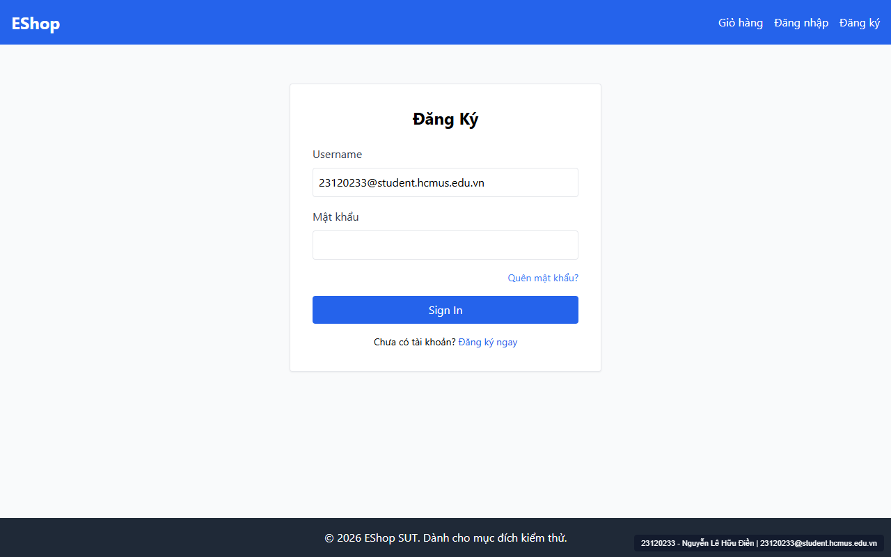

# [BUG-GUI-01] Không nhất quán ngôn ngữ trên trang Đăng nhập: dùng nhãn "Username" và nút "Sign In" bằng tiếng Anh

- **Khía cạnh Giao diện (Interface Aspect):** `IA-01: General UI standards` (`FR-21`)
- **Màn hình bị ảnh hưởng:** Trang Đăng nhập (`/login` — `frontend-web/src/pages/Login.jsx:28, 58`)
- **Mức độ nghiêm trọng (Severity):** **Medium** (Vi phạm tiêu chuẩn nhất quán ngôn ngữ toàn hệ thống)
- **Mã Checklist liên quan:** `CHK-002`

---

### 1. Mô tả lỗi (Description)
Theo đặc tả `FR-21 (Tiêu chuẩn Giao diện Chung)`: *"Nhất quán ngôn ngữ: Toàn bộ giao diện dùng tiếng Việt (trừ thuật ngữ kỹ thuật chuẩn)."* Tuy nhiên, trên trang Đăng nhập (`/login`), nhãn của trường nhập Email lại được viết bằng tiếng Anh là **`"Username"`** (thậm chí sai cả bản chất vì hệ thống đăng nhập bằng Email chứ không phải tên tài khoản), và nút gửi biểu mẫu lại được viết bằng tiếng Anh là **`"Sign In"`**.

### 2. Các bước tái hiện (Steps to Reproduce)
1. Mở trình duyệt truy cập `http://localhost:5173/login`.
2. Quan sát nhãn của ô nhập liệu đầu tiên và nhãn của nút bấm gửi biểu mẫu màu xanh dương.

### 3. Kết quả mong đợi (Expected Result)
- Nhãn của trường nhập liệu đầu tiên hiển thị là **`"Email *"`**.
- Nhãn của nút gửi biểu mẫu hiển thị bằng tiếng Việt là **`"Đăng nhập"`**.

### 4. Kết quả thực tế (Actual Result)
- Nhãn trường đầu tiên hiển thị là **`"Username"`** (`Login.jsx:28`).
- Nút bấm gửi biểu mẫu hiển thị là **`"Sign In"`** (`Login.jsx:58`).
- Đoạn mã lỗi tại `frontend-web/src/pages/Login.jsx`:
  ```jsx
  <label className="block text-gray-700 mb-2">Username</label>
  ...
  <button type="submit" className="w-full bg-blue-600 text-white py-2 rounded hover:bg-blue-700" tabIndex={1}>
    Sign In
  </button>
  ```

### 5. Ảnh chụp màn hình minh chứng (Screenshot)


### 6. Đề xuất khắc phục (Recommendation)
Đổi nhãn `<label>` thành `"Email *"` và văn bản trong nút `<button type="submit">` thành `"Đăng nhập"`.

---
- **GitHub Issue Link:** [Issue #29](https://github.com/denny188/CSC13003-eshop/issues/29)
