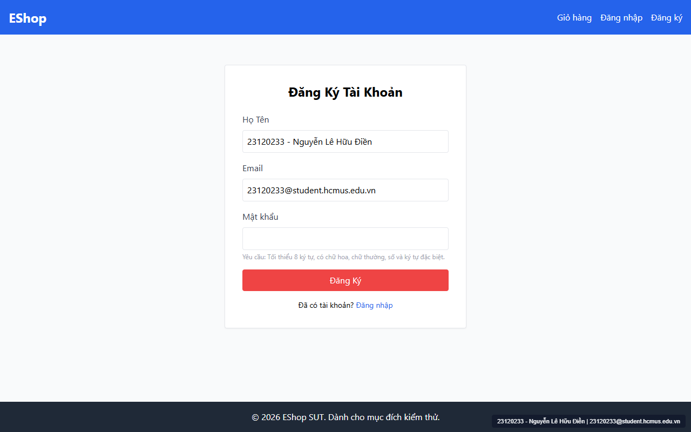
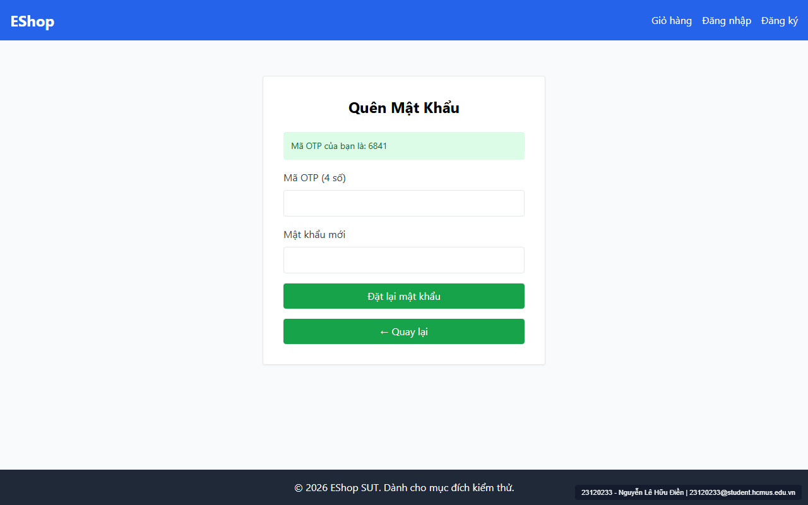

# [BUG-GUI-02] Sai quy chuẩn màu sắc nút hành động tích cực trên trang Đăng ký (dùng màu đỏ) & Quên mật khẩu (dùng màu xanh lá) kèm độ tương phản chữ gợi ý quá thấp

- **Khía cạnh Giao diện (Interface Aspect):** `IA-01: General UI standards` (`FR-21` & WCAG 2.1 AA)
- **Màn hình bị ảnh hưởng:** Trang Đăng ký (`/register` — `Register.jsx:64, 72`) & Quên mật khẩu (`/forgot-password` — `ForgotPassword.jsx:90-95`)
- **Mức độ nghiêm trọng (Severity):** **Medium** (Vi phạm chuẩn màu ngữ nghĩa `FR-21` và chuẩn tương phản WCAG AA)
- **Mã Checklist liên quan:** `CHK-003`, `CHK-005`, `CHK-041`

---

### 1. Mô tả lỗi (Description)
1. Đặc tả `FR-21` quy định rõ: *"Nhất quán màu sắc: Các nút hành động tích cực (Submit, Mua hàng) dùng màu xanh dương. Các nút nguy hiểm/hủy bỏ dùng màu đỏ."*
   - Trên trang `/register`, nút hành động chính **`"Đăng Ký"`** lại dùng màu đỏ (`bg-red-500 hover:bg-red-600`), khiến nút tạo tài khoản trông giống một nút xóa/hủy nguy hiểm.
   - Trên trang `/forgot-password` (Bước 2), cả nút chính **`"Đặt lại mật khẩu"`** lẫn nút phụ **`"← Quay lại"`** đều dùng cùng màu xanh lá (`bg-green-600`), vừa sai màu chuẩn xanh dương, vừa không phân biệt được đâu là nút chính và đâu là nút quay lại.
2. Ngoài ra, dòng văn bản gợi ý quy tắc mật khẩu trên `/register` dùng lớp `text-gray-400` (`#9ca3af`) trên nền trắng (`#ffffff`), tỷ lệ tương phản chỉ đạt **2.54:1** (thấp hơn nhiều so với mức tối thiểu **4.5:1** của chuẩn WCAG 2.1 AA).

### 2. Các bước tái hiện (Steps to Reproduce)
1. Truy cập `http://localhost:5173/register`, quan sát màu của nút `"Đăng Ký"` và dòng chữ gợi ý quy tắc mật khẩu bên dưới ô Mật khẩu.
2. Truy cập `http://localhost:5173/forgot-password`, nhập email `test@eshop.com`, bấm `"Lấy mã OTP"` để sang Bước 2 và quan sát 2 nút `"Đặt lại mật khẩu"` và `"← Quay lại"`.

### 3. Kết quả mong đợi (Expected Result)
- Nút `"Đăng Ký"` (`/register`) và `"Đặt lại mật khẩu"` (`/forgot-password`) phải dùng màu xanh dương (`bg-blue-600 hover:bg-blue-700`).
- Nút `"← Quay lại"` phải dùng màu trung tính phụ (`bg-gray-200 text-gray-800`).
- Dòng chữ gợi ý mật khẩu phải dùng màu tối thiểu `text-gray-600` (`#4b5563`, tỷ lệ tương phản `7.56:1` đạt chuẩn WCAG AA).

### 4. Kết quả thực tế (Actual Result)
- Nút `"Đăng Ký"` có màu đỏ (`bg-red-500`), chữ gợi ý mờ nhạt (`text-gray-400`).
- Hai nút ở Bước 2 trang Quên mật khẩu đều có màu xanh lá (`bg-green-600`).

### 5. Ảnh chụp màn hình minh chứng (Screenshots)

### 6. Đề xuất khắc phục (Recommendation)
- Tại `Register.jsx:64, 72`: Đổi `text-gray-400` thành `text-gray-600` và đổi `bg-red-500 hover:bg-red-600` thành `bg-blue-600 hover:bg-blue-700`.
- Tại `ForgotPassword.jsx:90-95`: Đổi nút `"Đặt lại mật khẩu"` sang `bg-blue-600 hover:bg-blue-700` và nút `"← Quay lại"` sang `bg-gray-200 text-gray-800 hover:bg-gray-300`.
