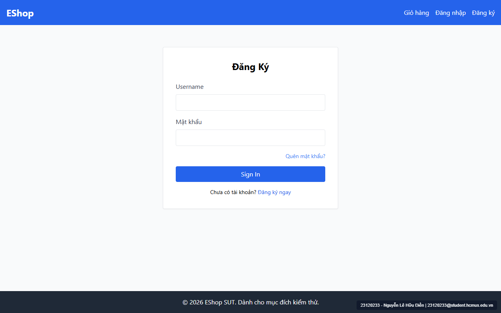

# [BUG-GUI-03] Tiêu đề trang Đăng nhập hiển thị sai thành "Đăng Ký" và toàn bộ các trang đều thiếu thẻ tiêu đề chính `<h1>`

- **Khía cạnh Giao diện (Interface Aspect):** `IA-01: General UI standards` (`FR-21`)
- **Màn hình bị ảnh hưởng:** `/login` (`Login.jsx:24`), `/register` (`Register.jsx:32`), `/forgot-password` (`ForgotPassword.jsx:43`), `/profile` (`Profile.jsx:113, 167`)
- **Mức độ nghiêm trọng (Severity):** **High** (Gây nhầm lẫn trực tiếp cho người dùng đang ở trang Đăng nhập nhưng thấy tiêu đề "Đăng Ký")
- **Mã Checklist liên quan:** `CHK-008`, `CHK-009`

---

### 1. Mô tả lỗi (Description)
1. **Sai nội dung tiêu đề trang `/login`:** Khi người dùng mở trang Đăng nhập (`/login`), tiêu đề lớn ở chính giữa biểu mẫu lại ghi là **`"Đăng Ký"`** thay vì `"Đăng Nhập"`, khiến người dùng tưởng mình bấm nhầm sang trang tạo tài khoản.
2. **Vi phạm quy chuẩn thẻ `<h1>` (`FR-21`):** Đặc tả `FR-21` quy định *"Tiêu đề trang: Mỗi trang có đúng 1 thẻ `<h1>` mô tả nội dung trang."* Tuy nhiên, cả 4 màn hình (`/register`, `/login`, `/forgot-password`, `/profile`) đều không có bất kỳ thẻ `<h1>` nào (`document.querySelectorAll('h1').length === 0`), tất cả đều dùng thẻ `<h2>`.

### 2. Các bước tái hiện (Steps to Reproduce)
1. Truy cập `http://localhost:5173/login` và quan sát dòng tiêu đề lớn của biểu mẫu.
2. Mở DevTools Console trên các trang `/register`, `/login`, `/forgot-password`, `/profile` và kiểm tra `document.querySelectorAll('h1').length`.

### 3. Kết quả mong đợi (Expected Result)
- Tiêu đề trên trang `/login` phải hiển thị là **`"Đăng Nhập"`**.
- Mỗi trang phải sử dụng đúng 1 thẻ `<h1>` cho tiêu đề chính của trang.

### 4. Kết quả thực tế (Actual Result)
- Tại `Login.jsx:24`: `<h2 className="text-2xl font-bold mb-6 text-center">Đăng Ký</h2>`.
- Tất cả các trang đều trả về `0` thẻ `<h1>`.

### 5. Ảnh chụp màn hình minh chứng (Screenshots)

### 6. Đề xuất khắc phục (Recommendation)
- Tại `Login.jsx:24`: Sửa thành `<h1 className="text-2xl font-bold mb-6 text-center">Đăng Nhập</h1>`.
- Tại `Register.jsx:32`, `ForgotPassword.jsx:43`, và `Profile.jsx`: Sử dụng đúng 1 thẻ `<h1>` cho tiêu đề cấp trang.

---
- **GitHub Issue Link:** [Issue #31](https://github.com/denny188/CSC13003-eshop/issues/31)
