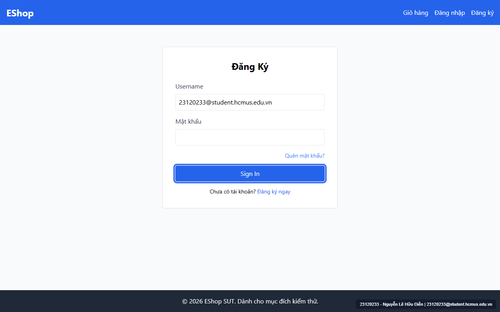

# [BUG-GUI-04] Thứ tự di chuyển phím Tab (Tab Order) trên trang Đăng nhập bị đảo lộn do gán cứng `tabIndex={1}` ở nút Submit

- **Khía cạnh Giao diện (Interface Aspect):** `IA-01: General UI standards` (`FR-21`)
- **Màn hình bị ảnh hưởng:** Trang Đăng nhập (`/login` — `frontend-web/src/pages/Login.jsx:56`)
- **Mức độ nghiêm trọng (Severity):** **Medium** (Phá vỡ luồng điều hướng bàn phím chuẩn `FR-21`)
- **Mã Checklist liên quan:** `CHK-010`

---

### 1. Mô tả lỗi (Description)
Theo đặc tả `FR-21`: *"Tab Order: Thứ tự focus theo Tab phải đi từ trên xuống dưới, trái sang phải."* Tuy nhiên, trên trang `/login`, nút gửi biểu mẫu `"Sign In"` ở dưới đáy form lại bị gán thuộc tính `tabIndex={1}` (`Login.jsx:56`), trong khi các phần tử phía trên (Header, ô Username, ô Mật khẩu, link Quên mật khẩu) đều có `tabIndex` mặc định là `0`. Theo quy tắc HTML DOM, trình duyệt sẽ ưu tiên nhảy vào mọi phần tử có `tabIndex > 0` trước tiên, khiến ngay lần bấm phím `Tab` đầu tiên trên trang, tiêu điểm (focus) nhảy vọt xuống nút `"Sign In"` ở dưới đáy form.

### 2. Các bước tái hiện (Steps to Reproduce)
1. Mở trang `http://localhost:5173/login`.
2. Nhấn phím `Tab` lần đầu tiên trên bàn phím và quan sát phần tử nhận focus (`document.activeElement`).

### 3. Kết quả mong đợi (Expected Result)
- Focus di chuyển tuần tự từ trên xuống dưới: `Thanh Header → Ô Email → Ô Mật khẩu → Link Quên mật khẩu? → Nút Đăng nhập → Link Đăng ký ngay`.

### 4. Kết quả thực tế (Actual Result)
- Nhấn `Tab` lần 1 nhảy thẳng xuống nút `"Sign In"` ở cuối form do dòng code tại `Login.jsx:53-59`:
  ```jsx
  <button
    type="submit"
    className="w-full bg-blue-600 text-white py-2 rounded hover:bg-blue-700"
    tabIndex={1}
  >
    Sign In
  </button>
  ```

### 5. Ảnh chụp màn hình minh chứng (Screenshot)


### 6. Đề xuất khắc phục (Recommendation)
Xóa bỏ thuộc tính `tabIndex={1}` khỏi thẻ `<button type="submit">` trong `Login.jsx:56` để trình duyệt tuân theo thứ tự DOM tự nhiên từ trên xuống dưới.

---
- **GitHub Issue Link:** [Issue #32](https://github.com/denny188/CSC13003-eshop/issues/32)
