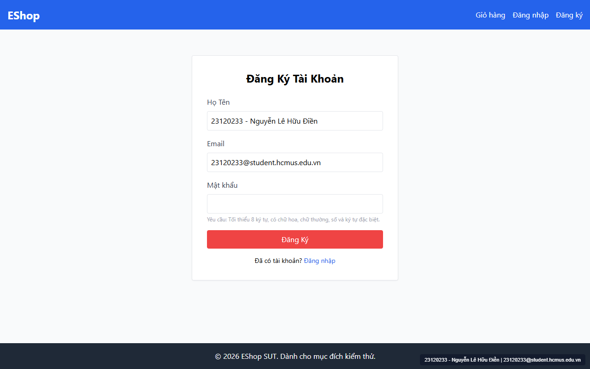

# [BUG-GUI-05] Toàn bộ các trường bắt buộc đều thiếu dấu `*` cạnh nhãn, thiếu liên kết `<label htmlFor>`/`<input id>` và thiếu `autocomplete`

- **Khía cạnh Giao diện (Interface Aspect):** `IA-02: Forms` (`FR-22` & WCAG 2.1 AA)
- **Màn hình bị ảnh hưởng:** `/register`, `/login`, `/forgot-password`, `/profile`
- **Mức độ nghiêm trọng (Severity):** **Medium** (Vi phạm trực tiếp yêu cầu `FR-22` trên cả 4 màn hình)
- **Mã Checklist liên quan:** `CHK-011`, `CHK-012`, `CHK-013`, `CHK-014`, `CHK-047`, `CHK-049`

---

### 1. Mô tả lỗi (Description)
1. **Thiếu dấu `*` ở tất cả các trường bắt buộc (`FR-22`):** Đặc tả `FR-22` quy định *"Tất cả trường bắt buộc phải có ký hiệu `*` bên cạnh nhãn."* Tuy nhiên, trên cả 4 màn hình (`/register`, `/login`, `/forgot-password`, `/profile`), dù các thẻ `<input>` đều đặt thuộc tính `required`, không có bất kỳ nhãn `<label>` nào hiển thị dấu `*`.
2. **Thiếu liên kết ngữ nghĩa `<label htmlFor>` và `<input id>`:** Toàn bộ các thẻ `<label>` và `<input>` trên 4 màn hình đều nằm rời rạc, không có thuộc tính `htmlFor` và `id`. Khi người dùng nhấp chuột vào nhãn chữ (ví dụ nhấp vào chữ `"Họ Tên"` hoặc `"Mật khẩu"`), con trỏ không focus vào ô nhập liệu, và trình đọc màn hình không thể xác định nhãn của ô nhập.
3. **Thiếu thuộc tính `autocomplete`:** Các trường Họ tên, Email, Mật khẩu, Số điện thoại, Địa chỉ không khai báo thuộc tính `autocomplete` chuẩn HTML5.

### 2. Các bước tái hiện (Steps to Reproduce)
1. Truy cập lần lượt `/register`, `/login`, `/forgot-password`, `/profile` và quan sát các nhãn trường bắt buộc.
2. Thử nhấp chuột trực tiếp vào chữ của nhãn `<label>` trên bất kỳ biểu mẫu nào.

### 3. Kết quả mong đợi (Expected Result)
- Mọi trường bắt buộc hiển thị dấu `*` màu đỏ cạnh nhãn (ví dụ: `Họ Tên *`, `Email *`, `Mật khẩu *`).
- Nhấp chuột vào `<label>` tự động đưa con trỏ vào `<input>` tương ứng nhờ `htmlFor` và `id`.

### 4. Kết quả thực tế (Actual Result)
- Không có nhãn nào có dấu `*`; không có thẻ `<label>` nào có `htmlFor`.

### 5. Ảnh chụp màn hình minh chứng (Screenshot)

### 6. Đề xuất khắc phục (Recommendation)
- Thêm `*` vào tất cả các nhãn của trường `required`.
- Bổ sung cặp `htmlFor` / `id` và thuộc tính `autocomplete` tương ứng cho mọi trường biểu mẫu.

---
- **GitHub Issue Link:** [Issue #33](https://github.com/denny188/CSC13003-eshop/issues/33)
