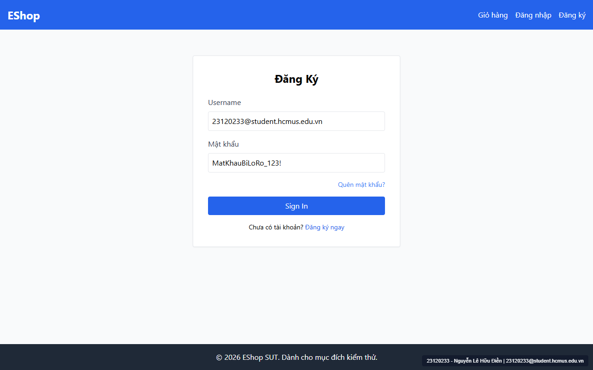

# [BUG-GUI-06] Ô Mật khẩu trang Đăng nhập dùng `type="text"` làm lộ mật khẩu dạng rõ; các ô Email và SĐT dùng sai `type="text"`

- **Khía cạnh Giao diện (Interface Aspect):** `IA-02: Forms` (`FR-22`, `FR-02`)
- **Màn hình bị ảnh hưởng:** `/login` (`Login.jsx:30, 40`), `/register` (`Register.jsx:48`), `/forgot-password` (`ForgotPassword.jsx:50`), `/profile` (`Profile.jsx:139`)
- **Mức độ nghiêm trọng (Severity):** **Critical** (Lộ mật khẩu trực tiếp trên màn hình và bỏ qua kiểm tra định dạng HTML5)
- **Mã Checklist liên quan:** `CHK-015`, `CHK-016`, `CHK-048`, `CHK-050`

---

### 1. Mô tả lỗi (Description)
Theo đặc tả `FR-22 (Form Requirements)`:
- *"Trường Email phải dùng `type="email"`."*
- *"Trường Mật khẩu phải dùng `type="password"` (không hiển thị rõ)."*

Tuy nhiên, trong mã nguồn thực tế:
1. **Lộ mật khẩu dạng rõ trên `/login` (`Login.jsx:40`):** Trường Mật khẩu lại khai báo `<input type="text">`, khiến mọi ký tự mật khẩu người dùng gõ vào hiển thị rõ mồn một trên màn hình.
2. **Dùng sai `type="text"` cho toàn bộ ô Email:** Cả 3 trang `/register` (`dòng 48`), `/login` (`dòng 30`), và `/forgot-password` (`dòng 50`) đều dùng `type="text"` thay vì `type="email"`.
3. **Dùng `type="text"` cho ô Số điện thoại (`Profile.jsx:139`):** Không dùng `type="tel"` và các ô mật khẩu cũng thiếu nút bật/tắt ẩn hiện mật khẩu chủ động.

### 2. Các bước tái hiện (Steps to Reproduce)
1. Mở trang `http://localhost:5173/login`.
2. Nhập email không hợp lệ (ví dụ `abc`) vào ô đầu tiên và nhập mật khẩu `Test1234!` vào ô Mật khẩu.
3. Quan sát văn bản hiển thị trong ô Mật khẩu và thuộc tính DOM của các thẻ `<input>`.

### 3. Kết quả mong đợi (Expected Result)
- Ô Mật khẩu phải dùng `type="password"` (hiển thị dấu chấm tròn `••••••••`).
- Các ô Email phải dùng `type="email"` và ô Số điện thoại dùng `type="tel"`.

### 4. Kết quả thực tế (Actual Result)
- Mật khẩu `Test1234!` hiển thị rõ thành chữ trên trang `/login` (`Login.jsx:40`):
  ```jsx
  <label className="block text-gray-700 mb-2">Mật khẩu</label>
  <input
    type="text"
    value={password}
    onChange={(e) => setPassword(e.target.value)}
    className="w-full border p-2 rounded"
    required
  />
  ```

### 5. Ảnh chụp màn hình minh chứng (Screenshot)


### 6. Đề xuất khắc phục (Recommendation)
- Đổi `type="text"` thành `type="password"` tại `Login.jsx:40`.
- Đổi `type="text"` thành `type="email"` tại `Register.jsx:48`, `Login.jsx:30`, `ForgotPassword.jsx:50`, và `type="tel"` tại `Profile.jsx:139`.

---
- **GitHub Issue Link:** [Issue #34](https://github.com/denny188/CSC13003-eshop/issues/34)
