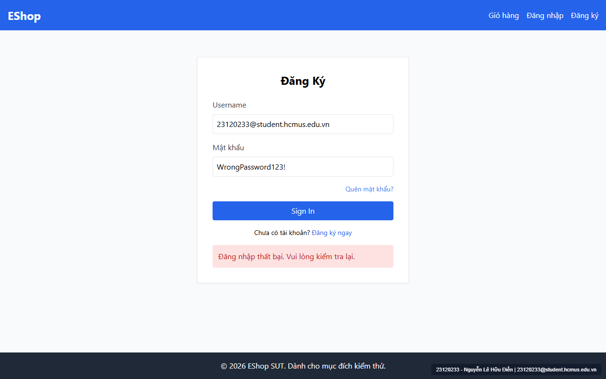
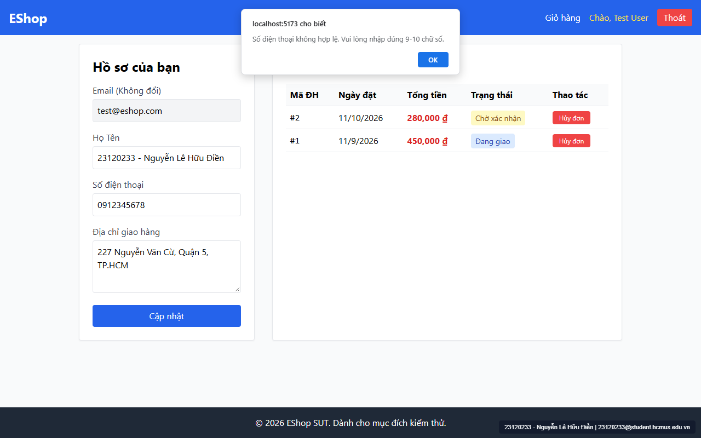

# [BUG-GUI-07] Thông báo lỗi trên trang Đăng nhập nằm bên dưới nút Submit; trang Hồ sơ & Quên mật khẩu dùng `window.alert()` chặn luồng thay vì thông báo inline

- **Khía cạnh Giao diện (Interface Aspect):** `IA-02: Forms` & `IA-04: Feedback / state` (`FR-22`, `FR-24`)
- **Màn hình bị ảnh hưởng:** `/login` (`Login.jsx:66`), `/forgot-password` (`ForgotPassword.jsx:20, 28, 34, 37`), `/profile` (`Profile.jsx:42, 58, 60, 73, 76`)
- **Mức độ nghiêm trọng (Severity):** **Medium** (Vi phạm quy chuẩn vị trí thông báo lỗi `FR-22` và gây gián đoạn trải nghiệm người dùng)
- **Mã Checklist liên quan:** `CHK-018`, `CHK-036`, `CHK-054`

---

### 1. Mô tả lỗi (Description)
Theo đặc tả `FR-22`: *"Thông báo lỗi phải xuất hiện trên nút submit, không phải bên dưới."*
1. **Trên trang `/login` (`Login.jsx:66`):** Khi đăng nhập thất bại, khung thông báo lỗi màu đỏ (`"Đăng nhập thất bại. Vui lòng kiểm tra lại."`) lại được đặt ở **bên dưới** nút `"Sign In"` và nằm ngoài thẻ `<form>`.
2. **Dùng hộp thoại `window.alert()` chặn luồng (`ForgotPassword.jsx` & `Profile.jsx`):** Khi có lỗi kiểm tra dữ liệu (SĐT không hợp lệ, mật khẩu yếu, OTP sai) hoặc khi cập nhật thành công, hệ thống không hiển thị thông báo trực tuyến (inline/toast) phía trên nút Submit mà gọi hàm `alert()` của trình duyệt làm đóng băng giao diện.
3. **Thiếu `role="alert"`:** Các khung báo lỗi không có thuộc tính `role="alert"` / `aria-live` cho công nghệ hỗ trợ tiếp cận.

### 2. Các bước tái hiện (Steps to Reproduce)
1. Truy cập `http://localhost:5173/login`, nhập tài khoản sai và bấm `"Sign In"`, quan sát vị trí xuất hiện của khung báo lỗi màu đỏ.
2. Đăng nhập và vào `http://localhost:5173/profile`, nhập Số điện thoại `0912345678` và bấm `"Cập nhật"`, quan sát hộp thoại `alert()` bật lên.

### 3. Kết quả mong đợi (Expected Result)
- Mọi thông báo lỗi biểu mẫu hiển thị inline ngay **phía trên** nút Submit với thuộc tính `role="alert"`.
- Không sử dụng hộp thoại `window.alert()` của trình duyệt.

### 4. Kết quả thực tế (Actual Result)
- Khung báo lỗi ở `/login` nằm dưới cùng của thẻ Card (`Login.jsx:66`), bên dưới cả nút `"Sign In"` và link `"Đăng ký ngay"`.
- `/profile` và `/forgot-password` bật hộp thoại `window.alert()`.

### 5. Ảnh chụp màn hình minh chứng (Screenshots)

### 6. Đề xuất khắc phục (Recommendation)
- Di chuyển khối `{error && 
{error}
}` vào bên trong `<form>` ngay phía trên nút Submit.
- Thay thế toàn bộ lệnh `alert()` trong `Profile.jsx` và `ForgotPassword.jsx` bằng state thông báo inline/toast.

---
- **GitHub Issue Link:** [Issue #35](https://github.com/denny188/CSC13003-eshop/issues/35)
