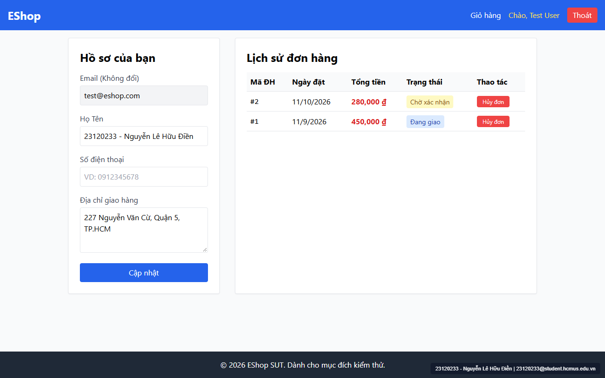

# [BUG-GUI-08] Thanh điều hướng (Navbar) vi phạm hàng loạt yêu cầu FR-23: không highlight trang hiện tại, thiếu badge giỏ hàng, nút đăng xuất ghi "Thoát", thiếu Breadcrumb và dùng `dangerouslySetInnerHTML`

- **Khía cạnh Giao diện (Interface Aspect):** `IA-03: Navigation` & `IA-04: Feedback / state` (`FR-23`)
- **Màn hình bị ảnh hưởng:** Thanh điều hướng chung `Header` (`frontend-web/src/App.jsx:15-40`) và toàn bộ các trang con (`/register`, `/login`, `/forgot-password`, `/profile`)
- **Mức độ nghiêm trọng (Severity):** **High** (Vi phạm đồng thời cả 4 yêu cầu của `FR-23` và chứa lỗi hiển thị DOM/XSS trên Header)
- **Mã Checklist liên quan:** `CHK-023`, `CHK-024`, `CHK-025`, `CHK-026`, `CHK-029`, `CHK-046`, `CHK-055`

---

### 1. Mô tả lỗi (Description)
Đối chiếu component `Header` (`App.jsx:15-40`) với đặc tả `FR-23 (Navigation Requirements)` phát hiện 6 lỗi giao diện và điều hướng:
1. **Không highlight trang đang được chọn (`CHK-023`):** Tất cả các liên kết trên Navbar (`Giỏ hàng`, `Đăng nhập`, `Đăng ký`, `Chào, ...`) chỉ dùng `<Link className="hover:underline">` tĩnh mà không dùng `<NavLink>` để đánh dấu trang hiện hành.
2. **Thiếu badge số lượng sản phẩm ở link `"Giỏ hàng"` (`CHK-024`):** Mặc dù dòng 17 đã lấy `const { cart } = useCart()`, nhưng dòng 23 chỉ render `<Link to="/cart">Giỏ hàng</Link>` mà không hiển thị huy hiệu số lượng sản phẩm.
3. **Sai nhãn nút Đăng xuất (`CHK-025`):** `FR-23` quy định *"Nút Đăng xuất phải nhãn là 'Đăng xuất' (không phải 'Thoát')"*, nhưng dòng 29 lại viết `<button onClick={logout} ...>Thoát</button>`.
4. **Thiếu Breadcrumb ở tất cả các trang con (`CHK-026`):** Các trang con không có thanh điều hướng phân cấp Breadcrumb.
5. **Dùng `<a href="/forgot-password">` gây reload toàn trang (`CHK-029`):** Trên trang `/login` (`Login.jsx:50`), link Quên mật khẩu dùng thẻ `<a>` thuần thay vì `<Link>` của React Router.
6. **Dùng `dangerouslySetInnerHTML` và không giới hạn chiều rộng tên người dùng trên Header (`CHK-046`, `CHK-055`):** Dòng 27 dùng `` vừa gây vỡ bố cục Header khi tên dài hoặc chứa ký tự `<`, vừa tạo lỗ hổng Stored XSS.

### 2. Các bước tái hiện (Steps to Reproduce)
1. Đăng nhập tài khoản `test@eshop.com` / `Test1234!`, thêm 1 sản phẩm vào giỏ hàng, sau đó chuyển sang trang `/profile`.
2. Quan sát thanh Navbar màu xanh dương phía trên cùng của trang.

### 3. Kết quả mong đợi (Expected Result)
- Mục trang hiện tại được highlight nổi bật; link `"Giỏ hàng"` có badge số lượng (ví dụ `Giỏ hàng (1)`); nút đăng xuất có nhãn `"Đăng xuất"`; có thanh Breadcrumb dưới Header; tên người dùng được render thuần bằng `{user.name}` kèm lớp `truncate max-w-xs`.

### 4. Kết quả thực tế (Actual Result)
- Không có mục nào được highlight; không có badge số lượng giỏ hàng; nút đăng xuất ghi `"Thoát"`; không có Breadcrumb (`App.jsx:20-38`).

### 5. Ảnh chụp màn hình minh chứng (Screenshot)

### 6. Đề xuất khắc phục (Recommendation)
- Sử dụng `<NavLink>` trong `App.jsx`, render badge `{cart.length}`, đổi `"Thoát"` thành `"Đăng xuất"`, thay `dangerouslySetInnerHTML` bằng `Chào, {user.name}`, và bổ sung component `Breadcrumb`.
