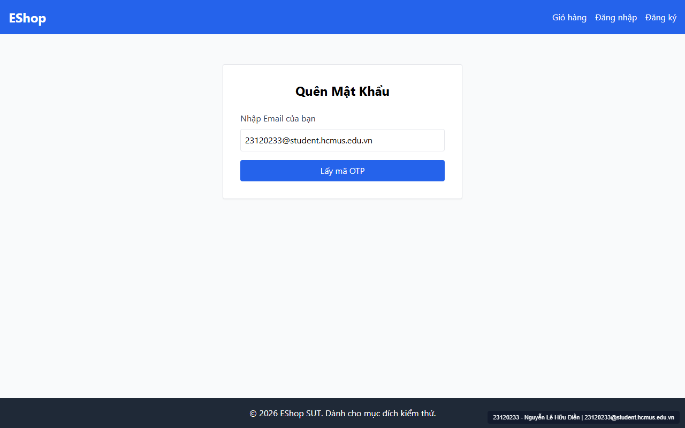
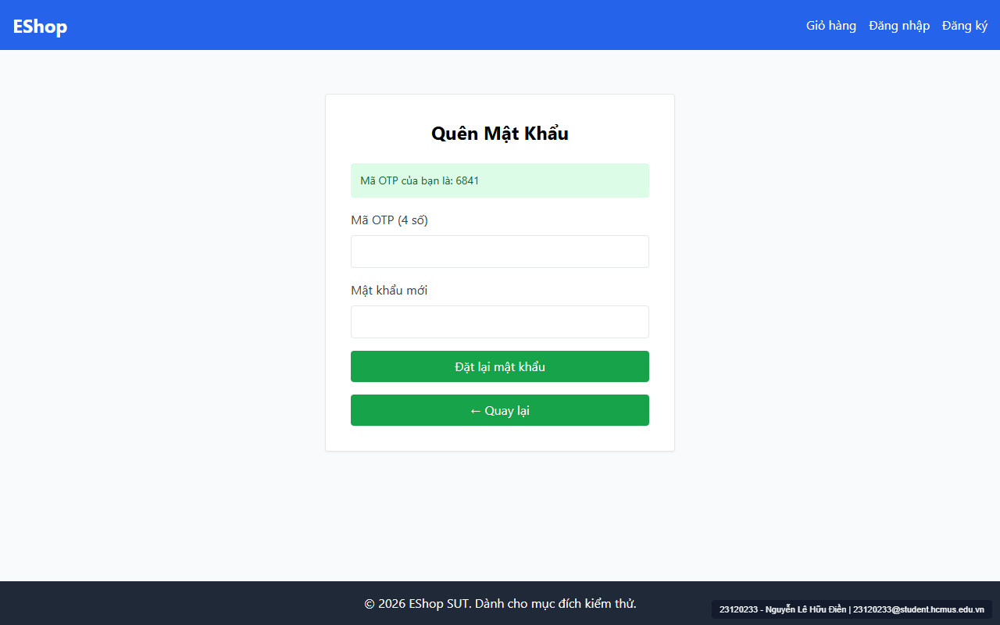

# [BUG-GUI-09] Màn hình Quên mật khẩu & Đăng ký thiếu Step Indicator (Bước 1/2), thiếu nút "Quay lại đăng nhập", thiếu trường "Xác nhận mật khẩu" và sai nhãn OTP 4 số

- **Khía cạnh Giao diện (Interface Aspect):** `IA-02: Forms`, `IA-03: Navigation`, `IA-04: Feedback / state` (`FR-01`, `FR-03`, `FR-22`)
- **Màn hình bị ảnh hưởng:** `/forgot-password` (`ForgotPassword.jsx`) & `/register` (`Register.jsx`)
- **Mức độ nghiêm trọng (Severity):** **High** (Thiếu thành phần giao diện bắt buộc của biểu mẫu nhiều bước và thiếu trường xác nhận mật khẩu)
- **Mã Checklist liên quan:** `CHK-020`, `CHK-021`, `CHK-027`, `CHK-039`

---

### 1. Mô tả lỗi (Description)
Đối chiếu với đặc tả `FR-01`, `FR-03` và `FR-22`:
1. **Thiếu Step Indicator (`CHK-020` — `FR-03`, `FR-22`):** Trang `/forgot-password` là biểu mẫu gồm 2 bước nhưng hoàn toàn không hiển thị chỉ báo bước (ví dụ: `"Bước 1 / 2"` và `"Bước 2 / 2"`).
2. **Thiếu nút `"Quay lại đăng nhập"` ở Bước 1 (`CHK-027` — `FR-03`):** Tại Bước 1 của `/forgot-password`, người dùng bấm nhầm vào trang này không có bất kỳ nút hay liên kết nào để quay lại trang `/login`.
3. **Thiếu trường `"Xác nhận mật khẩu"` (`CHK-021` — `FR-01`, `FR-03`):** Cả biểu mẫu `/register` lẫn Bước 2 của `/forgot-password` đều chỉ có 1 ô nhập mật khẩu duy nhất, thiếu ô nhập lại để xác nhận mật khẩu.
4. **Sai độ dài và nhãn OTP (`CHK-039` — `FR-03`):** Đặc tả yêu cầu mã OTP 6 chữ số, nhưng hệ thống sinh mã 4 chữ số và hiển thị nhãn `"Mã OTP (4 số)"` (`ForgotPassword.jsx:69`).

### 2. Các bước tái hiện (Steps to Reproduce)
1. Truy cập `http://localhost:5173/forgot-password`, quan sát giao diện Bước 1.
2. Nhập `test@eshop.com` và bấm `"Lấy mã OTP"` để chuyển sang Bước 2, quan sát các trường trong biểu mẫu.

### 3. Kết quả mong đợi (Expected Result)
- Hiển thị rõ `"Bước 1 / 2"` và `"Bước 2 / 2"`.
- Bước 1 có nút/liên kết `"Quay lại đăng nhập"`.
- Cả `/register` và Bước 2 `/forgot-password` đều có trường `"Xác nhận mật khẩu *"`.
- Mã OTP gồm 6 chữ số với nhãn `"Mã OTP (6 số) *"`.

### 4. Kết quả thực tế (Actual Result)
- Hoàn toàn không có Step Indicator, không có nút Quay lại đăng nhập ở Bước 1, không có ô Xác nhận mật khẩu, và nhãn OTP ghi `"Mã OTP (4 số)"`.

### 5. Ảnh chụp màn hình minh chứng (Screenshots)

### 6. Đề xuất khắc phục (Recommendation)
Bổ sung thanh tiến trình `Bước {step} / 2`, thêm `<Link to="/login">← Quay lại đăng nhập</Link>` ở Bước 1, thêm trường `confirmPassword` ở cả 2 form, và sửa độ dài OTP thành 6 chữ số.
