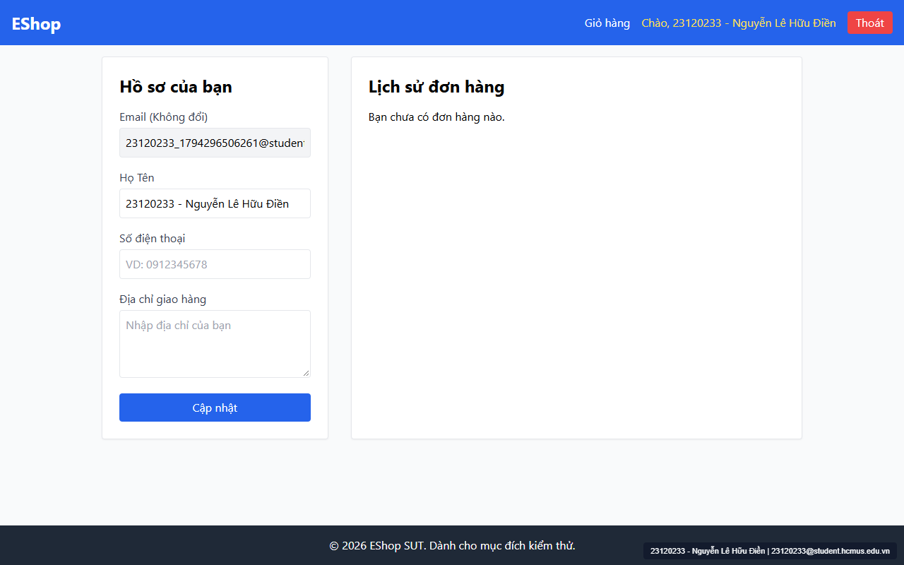
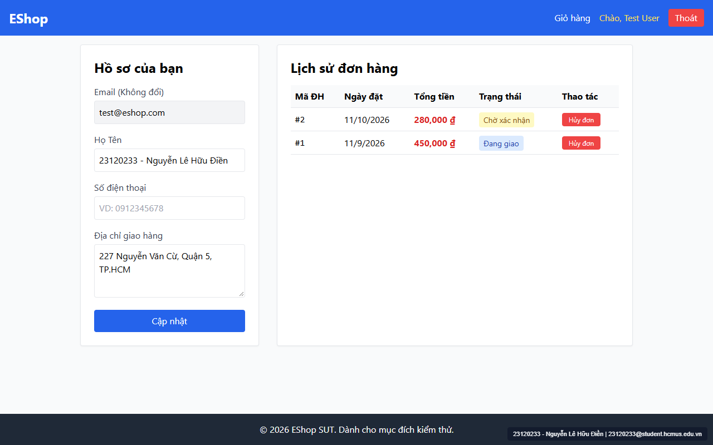
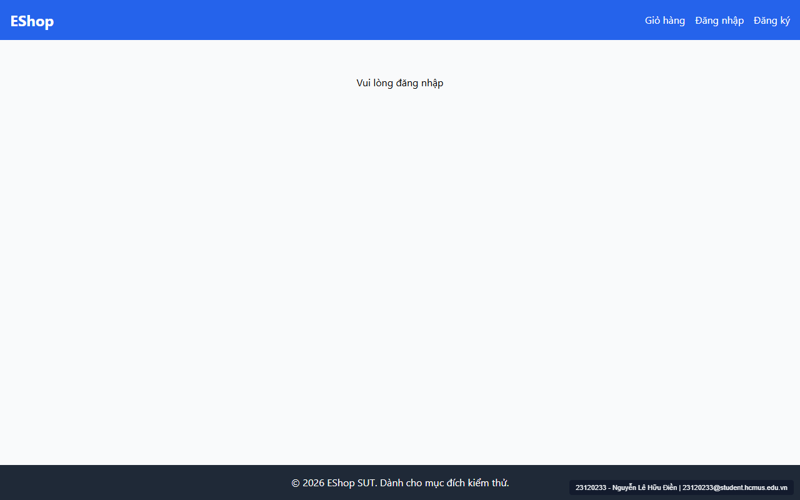

# [BUG-GUI-10] Trang Hồ sơ & Lịch sử đơn hàng: Empty State thiếu hình minh họa, hủy đơn không có hộp thoại xác nhận, vẫn hiện nút Hủy khi đơn "Đang giao" và ngõ cụt khi chưa đăng nhập

- **Khía cạnh Giao diện (Interface Aspect):** `IA-03: Navigation` & `IA-04: Feedback / state` (`FR-10`, `FR-11`, `FR-24`)
- **Màn hình bị ảnh hưởng:** Trang Hồ sơ & Lịch sử đơn hàng (`/profile` — `frontend-web/src/pages/Profile.jsx`)
- **Mức độ nghiêm trọng (Severity):** **High** (Vi phạm quy tắc trạng thái đơn hàng `FR-10` và các yêu cầu phản hồi trạng thái `FR-24`)
- **Mã Checklist liên quan:** `CHK-032`, `CHK-033`, `CHK-035`, `CHK-052`

---

### 1. Mô tả lỗi (Description)
Trên màn hình `/profile` (`Profile.jsx`), có 4 lỗi về hiển thị trạng thái và phản hồi tương tác:
1. **Empty State của Lịch sử đơn hàng thiếu icon/hình minh họa (`CHK-032` — `FR-24`):** Khi tài khoản chưa có đơn hàng nào (`orders.length === 0`), dòng 169 chỉ hiển thị văn bản thuần `
Bạn chưa có đơn hàng nào.
`, không có icon/hình minh họa và không có nút hướng dẫn người dùng đi mua sắm.
2. **Hủy đơn hàng không có hộp thoại xác nhận (`CHK-033` — `FR-24`):** Khi nhấn nút `"Hủy đơn"`, hàm `cancelOrder` (`dòng 64`) gửi ngay request hủy đơn lên server mà không hiển thị hộp thoại xác nhận, rất dễ làm người dùng hủy nhầm đơn hàng.
3. **Vẫn hiển thị nút `"Hủy đơn"` khi đơn hàng đang ở trạng thái `"Đang giao"` (`CHK-035` — `FR-10`):** Dòng 200 kiểm tra `o.status !== "delivered" && o.status !== "canceled"`, dẫn đến đơn hàng đang ở trạng thái `"shipping"` (`Đang giao`) vẫn hiện nút `"Hủy đơn"` màu đỏ.
4. **Ngõ cụt điều hướng khi truy cập `/profile` lúc chưa đăng nhập (`CHK-052`):** Khi chưa đăng nhập (hoặc vừa bấm nút `"Thoát"` khi đang đứng ở `/profile`), trang chỉ hiển thị `
Vui lòng đăng nhập
` (`dòng 108`) mà không tự chuyển hướng về `/login` hay cung cấp đường link đăng nhập.

### 2. Các bước tái hiện (Steps to Reproduce)
1. Đăng nhập một tài khoản mới chưa có đơn hàng và mở `/profile` để quan sát Empty State.
2. Đăng nhập tài khoản có các đơn hàng ở trạng thái `Chờ xác nhận` và `Đang giao`, quan sát nút `"Hủy đơn"` và bấm thử vào nút `"Hủy đơn"`.
3. Bấm nút `"Thoát"` trên thanh Navbar khi đang ở `/profile`.

### 3. Kết quả mong đợi (Expected Result)
- Empty State có icon minh họa, thông điệp thân thiện và nút `"Mua sắm ngay"`.
- Chỉ hiển thị nút `"Hủy đơn"` cho trạng thái `pending` và `confirmed`; khi bấm phải hiện hộp thoại xác nhận trước khi hủy.
- Tự động điều hướng về `/login` khi người dùng chưa đăng nhập.

### 4. Kết quả thực tế (Actual Result)
- Empty State chỉ có chữ trần; đơn `"Đang giao"` vẫn có nút `"Hủy đơn"`; bấm `"Hủy đơn"` hủy ngay không hỏi xác nhận; khi đăng xuất hiện chữ `"Vui lòng đăng nhập"` cụt lủn.

### 5. Ảnh chụp màn hình minh chứng (Screenshots)

### 6. Đề xuất khắc phục (Recommendation)
- Sửa điều kiện tại `Profile.jsx:200` thành `(o.status === "pending" || o.status === "confirmed")`.
- Bổ sung modal xác nhận trước khi gọi API hủy đơn, thêm icon minh họa cho Empty State, và dùng `<Navigate to="/login" replace />` khi `!user`.
