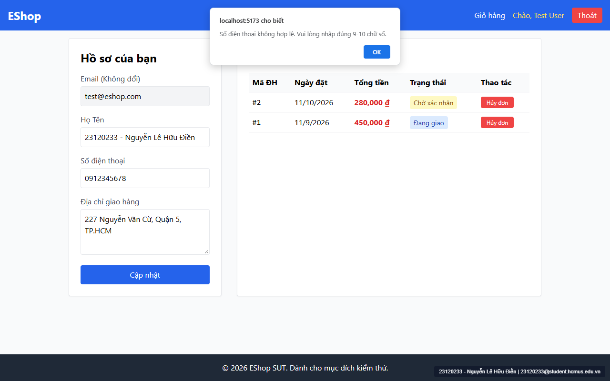
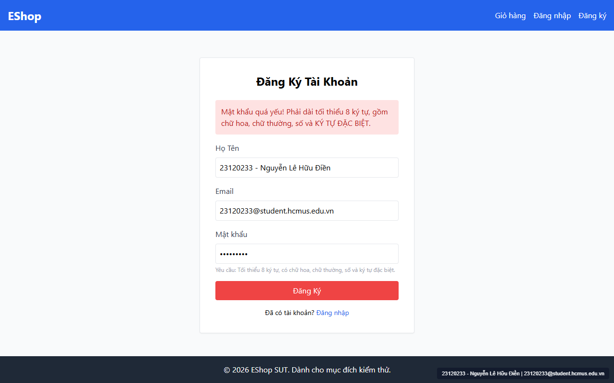

# [BUG-GUI-11] Biểu thức chính quy (Regex) trên UI bị lỗi logic: từ chối Số điện thoại bắt đầu bằng số `0` và từ chối Mật khẩu chứa ký tự đặc biệt chuẩn

- **Khía cạnh Giao diện (Interface Aspect):** `IA-04: Feedback / state` & `IA-02: Forms` (`FR-01`, `FR-03`, `FR-04`)
- **Màn hình bị ảnh hưởng:** `/profile` (`Profile.jsx:41, 143`), `/register` (`Register.jsx:15, 65`), `/forgot-password` (`ForgotPassword.jsx:26`)
- **Mức độ nghiêm trọng (Severity):** **Critical** (Chặn hoàn toàn người dùng nhập dữ liệu hợp lệ theo đúng hướng dẫn trên giao diện)
- **Mã Checklist liên quan:** `CHK-037`, `CHK-038`

---

### 1. Mô tả lỗi (Description)
Có sự mâu thuẫn nghiêm trọng giữa văn bản hướng dẫn trên giao diện (UI Hint / Placeholder) và biểu thức chính quy kiểm tra dữ liệu phía Client:
1. **Lỗi chặn Số điện thoại bắt đầu bằng số `0` trên `/profile` (`CHK-037`):**
   - Đặc tả `FR-04` quy định: *"Số điện thoại hợp lệ: bắt đầu bằng số `0`, từ 10-11 chữ số."*
   - Ô nhập Số điện thoại tại `Profile.jsx:143` cũng hiển thị gợi ý: `placeholder="VD: 0912345678"`.
   - Thế nhưng tại `Profile.jsx:41`, lập trình viên lại kiểm tra bằng biểu thức `!/^[1-9][0-9]{8,9}$/.test(phone)` (**bắt buộc chữ số đầu tiên từ `1–9`, cấm số `0` ở đầu!**). Hậu quả là khi người dùng nhập đúng `0912345678` theo gợi ý, hệ thống lập tức bật alert báo lỗi: `"Số điện thoại không hợp lệ. Vui lòng nhập đúng 9-10 chữ số."`
2. **Lỗi bắt buộc khoảng trắng thay vì ký tự đặc biệt ở Mật khẩu (`CHK-038`):**
   - Trên `/register` và `/forgot-password`, giao diện yêu cầu mật khẩu có *chữ hoa, chữ thường, số và ký tự đặc biệt*.
   - Tuy nhiên, biến `flawedStrongPasswordRegex` (`Register.jsx:15`, `ForgotPassword.jsx:26`) lại là `/^(?=.*[a-z])(?=.*[A-Z])(?=.*\d)(?=.*\s)[A-Za-z\d\s]{8,}$/` — dùng `\s` (khoảng trắng) thay vì `[@$!%*?&]`. Khi người dùng nhập mật khẩu chuẩn như `Test1234!`, giao diện chặn lại và báo lỗi `"Mật khẩu quá yếu!"`.

### 2. Các bước tái hiện (Steps to Reproduce)
1. Truy cập `http://localhost:5173/register`, nhập mật khẩu hợp lệ `Test1234!` và bấm `"Đăng Ký"`.
2. Đăng nhập và vào `http://localhost:5173/profile`, nhập Số điện thoại `0912345678` (đúng y hệt placeholder) và bấm `"Cập nhật"`.

### 3. Kết quả mong đợi (Expected Result)
- Chấp nhận mật khẩu chứa ký tự đặc biệt thuộc tập `@ $ ! % * ? &` theo `FR-01`.
- Chấp nhận số điện thoại bắt đầu bằng số `0` có độ dài 10–11 chữ số (`/^(0[0-9]{9,10})$/`) theo `FR-04`.

### 4. Kết quả thực tế (Actual Result)
- Cả hai trường hợp nhập đúng chuẩn đều bị giao diện báo lỗi từ chối.

### 5. Ảnh chụp màn hình minh chứng (Screenshots)

### 6. Đề xuất khắc phục (Recommendation)
- Tại `Profile.jsx:41`: Sửa regex thành `/^0\d{9,10}$/`.
- Tại `Register.jsx:15` và `ForgotPassword.jsx:26`: Sửa regex thành `/^(?=.*[a-z])(?=.*[A-Z])(?=.*\d)(?=.*[@$!%*?&])[A-Za-z\d@$!%*?&]{8,}$/`.

---
- **GitHub Issue Link:** [Issue #39](https://github.com/denny188/CSC13003-eshop/issues/39)
