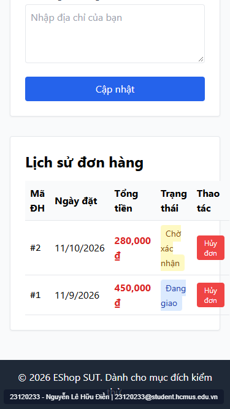

# [BUG-GUI-12] Khiếm khuyết khả năng đáp ứng & trạng thái nâng cao: Bảng đơn hàng 5 cột bị tràn ở màn hình di động `375px`, thiếu hỗ trợ Dark Mode / RTL và không khóa nút Submit khi đang gửi API

- **Khía cạnh Giao diện (Interface Aspect):** `IA-01: General UI standards` & `IA-04: Feedback / state`
- **Màn hình bị ảnh hưởng:** `/profile` (`Profile.jsx:171`), `/register`, `/login`, `/forgot-password`
- **Mức độ nghiêm trọng (Severity):** **Low / Minor** (Ảnh hưởng tới khả năng hiển thị trên màn hình nhỏ, chế độ tối và chống bấm đúp)
- **Mã Checklist liên quan:** `CHK-042`, `CHK-043`, `CHK-044`, `CHK-053`

---

### 1. Mô tả lỗi (Description)
Các kiểm tra mở rộng (do con người bổ sung trong bước AI Gap Review) phát hiện 4 vấn đề về bố cục thích ứng và trạng thái tương tác:
1. **Tràn bảng Lịch sử đơn hàng trên màn hình hẹp `375px` (`CHK-043`):** Tại `Profile.jsx:171`, thẻ `<table className="w-full text-left">` gồm 5 cột không được đặt trong thẻ `
`, khiến trên màn hình điện thoại `375×667px` các cột bị ép sát và tràn ngang khỏi khung trắng.
2. **Không hỗ trợ Chế độ tối (`CHK-042` — Dark Mode):** Khi hệ điều hành hoặc trình duyệt bật `prefers-color-scheme: dark`, giao diện không có cấu hình màu tối tương ứng.
3. **Dùng lớp căn lề vật lý cứng khi chuyển sang `dir="rtl"` (`CHK-044`):** Bảng đơn hàng dùng `text-left` và link Quên mật khẩu dùng `text-right` thay vì thuộc tính logic `text-start` / `text-end`.
4. **Không khóa nút Submit khi đang chờ phản hồi mạng (`CHK-053`):** Các biểu mẫu không có biến state `isSubmitting` để khóa (`disabled`) nút Submit khi đang gọi API.

### 2. Các bước tái hiện (Steps to Reproduce)
1. Mở `/profile` trên trình duyệt ở kích thước màn hình di động `375×667px` (hoặc bật chế độ `prefers-color-scheme: dark` và `dir="rtl"`).
2. Quan sát sự hiển thị của bảng Lịch sử đơn hàng 5 cột.

### 3. Kết quả mong đợi (Expected Result)
- Bảng đơn hàng được bọc trong `
` để cuộn ngang mượt mà trên màn hình nhỏ; dùng thuộc tính căn lề logic `text-start`/`text-end`; nút Submit chuyển sang trạng thái `disabled` khi đang gửi dữ liệu.

### 4. Kết quả thực tế (Actual Result)
- Bảng đơn hàng bị tràn/bóp nghẹt trên khung nhìn `375px`, căn lề ngược khi bật RTL, và nút Submit không bị khóa khi gửi API.

### 5. Ảnh chụp màn hình minh chứng (Screenshot)

### 6. Đề xuất khắc phục (Recommendation)
Bọc `<table>` trong `
`, thay `text-left`/`text-right` bằng `text-start`/`text-end`, và bổ sung state `isSubmitting` cho các biểu mẫu.

---
- **GitHub Issue Link:** [Issue #40](https://github.com/denny188/CSC13003-eshop/issues/40)
