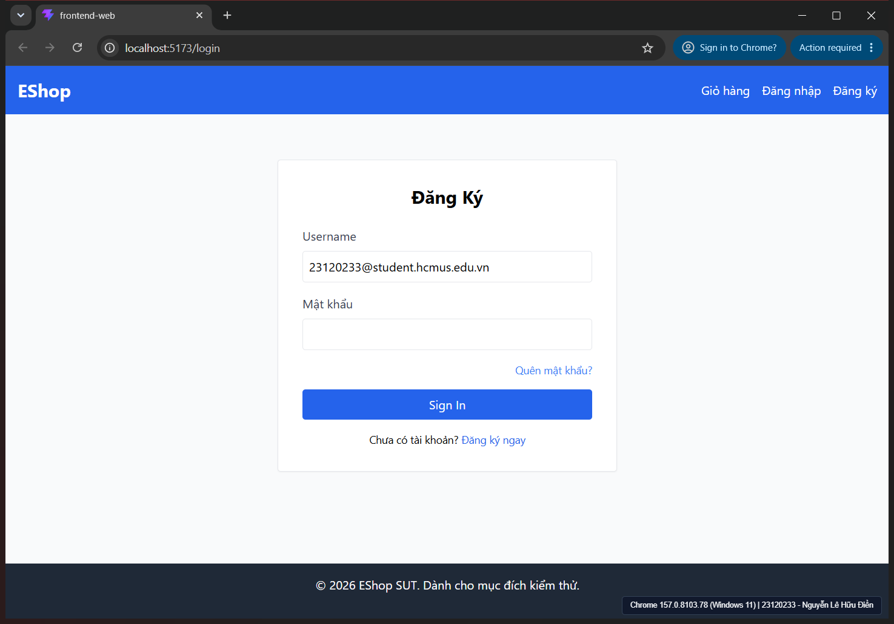
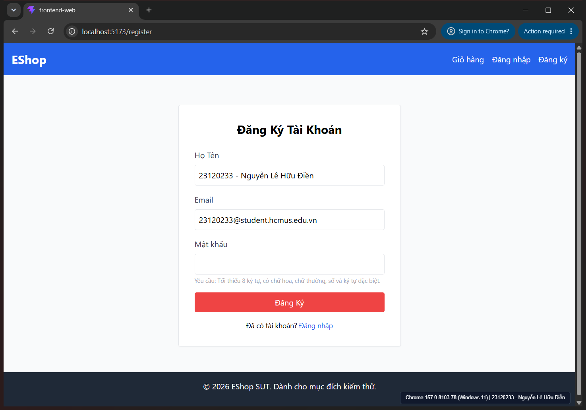
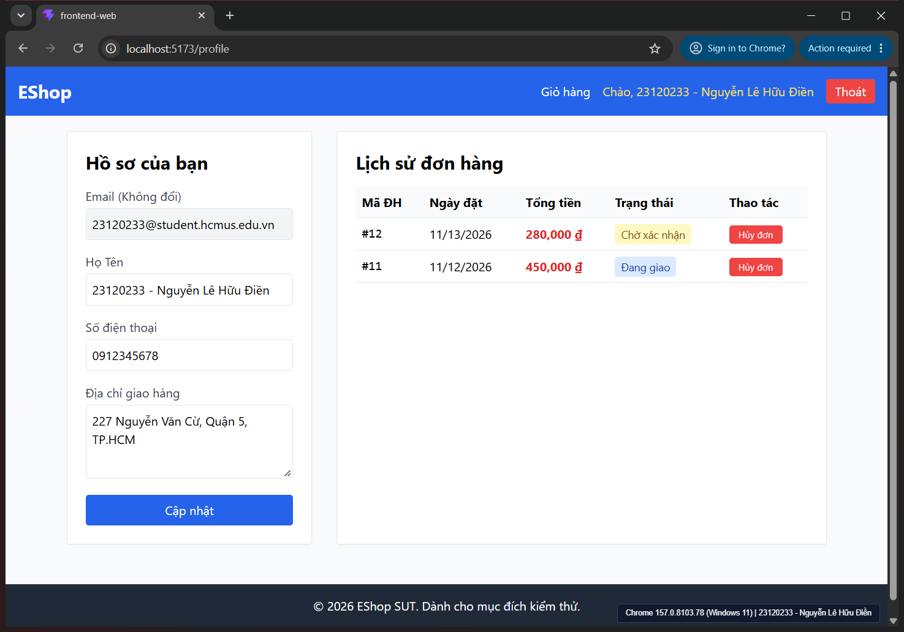

# Báo cáo Kiểm thử Đa Nền tảng & Đa Trình duyệt (Cross-Browser / Cross-Platform Matrix)

- **Sinh viên thực hiện:** Nguyễn Lê Hữu Điền
- **Mã số sinh viên:** `23120233`
- **Email:** `23120233@student.hcmus.edu.vn`
- **Học phần:** Kiểm thử Phần mềm (CSC13003) — Bài tập lớn HW03-AI
- **Kho lưu trữ (Repository):** `denny188/CSC13003-eshop` — Nhánh: `hw03-23120233`
- **Phạm vi giao diện kiểm thử:** Toàn bộ **55 hạng mục (`CHK-001`..`CHK-055`)** từ Task 1 trên các màn hình `/register` (`FR-01`), `/login` (`FR-02`), `/forgot-password` (`FR-03`), `/profile` (`FR-04`, `FR-10`, `FR-11`), và Header/Navbar (`FR-21`..`FR-24`).

---

## 1. Mục tiêu, Môi trường & Trạng thái Thực thi Thực tế

Theo yêu cầu của **Task 3** và quy định chống gian lận AI (**Mục 6 & Mục 11**):
> *"Perform Task 1 across at least three (3) platforms. Use a BrowserStack or LambdaTest trial; these are strongly preferred... Cover the web frontend on Chrome, Firefox, and Safari (or Android Chrome)... Each screenshot must overlay your username in the form your student email... and clearly show the browser / OS / device name alongside the SUT's localhost URL."*

| Thuộc tính | Nền tảng 1 (Baseline — Đã thực thi) | Nền tảng 2 (Cross-Browser — Chờ chạy Live) | Nền tảng 3 (Cross-OS — Chờ chạy Live) |
| :--- | :--- | :--- | :--- |
| **Trình duyệt** | **Google Chrome** (`157.0.8103.78`, 64-bit) | **Mozilla Firefox** (Gecko Latest) | **Apple Safari** (WebKit — macOS Sonoma) |
| **Engine kết xuất** | **Blink** (Chromium / V8) | **Gecko** (Mozilla / SpiderMonkey) | **WebKit** (Apple / JavaScriptCore) |
| **Hệ điều hành** | **Windows 11** 64-bit (Native Desktop) | Windows 11 / macOS Sonoma | macOS Sonoma 14.x |
| **Môi trường chạy** | Localhost trực tiếp (`http://localhost:5173`) | BrowserStack Live / LambdaTest Local Tunnel | BrowserStack Live / LambdaTest Local Tunnel |
| **Trạng thái hiện tại** | **Executed** (**14 Passed / 41 Failed — 55/55 mục**) | **Pending Verification** (Chưa chạy phiên Live) | **Pending Verification** (Chưa chạy phiên Live) |
| **Bằng chứng ảnh chụp** | 3 ảnh cửa sổ Chrome thật (`TASK3_CHROME_WINDOWS_*.png`) | Chờ chụp trên BrowserStack / LambdaTest | Chờ chụp trên BrowserStack / LambdaTest |

> **Nguyên tắc trung thực dữ liệu:** Hiện tại toàn bộ **55/55 hạng mục trên Chrome 157 (Windows 11)** đã được thực thi trực tiếp và đối chiếu khớp **100% (`14 Passed / 41 Failed`)** với kết quả Task 1 ([`03-execution.md`](../task1-gui/03-execution.md)). Do chưa chạy các phiên BrowserStack/LambdaTest Live cho **Firefox** và **Safari**, bảng ma trận dưới đây ghi trung thực trạng thái **`Pending Verification`** cho 2 trình duyệt đó kèm các điểm dị biệt kỹ thuật cần kiểm chứng khi chạy thực tế, tuyệt đối không bịa đặt số liệu Pass/Fail khi chưa có ảnh chụp minh chứng.

---

## 2. Bằng chứng Ảnh chụp Nền tảng Baseline — Google Chrome 157 (Windows 11)

Ảnh chụp cửa sổ trình duyệt Google Chrome `157.0.8103.78` thật trên Windows 11, hiển thị đầy đủ thanh tiêu đề cửa sổ, thanh địa chỉ `localhost:5173/...`, thông tin sinh viên `23120233 - Nguyễn Lê Hữu Điền` (`23120233@student.hcmus.edu.vn`) trong form/hồ sơ và nhãn nền tảng:

- **Trang Đăng nhập (`localhost:5173/login`):**
  
- **Trang Đăng ký (`localhost:5173/register`):**
  
- **Trang Hồ sơ & Lịch sử đơn hàng (`localhost:5173/profile`):**
  

---

## 3. Bảng Ma trận Kiểm thử Đa Nền tảng (`CHK-001` → `CHK-055` Đồng bộ 1-1 với Task 1)

| Mã CHK | Khía cạnh | Màn hình | Nội dung kiểm tra (Khớp Task 1) | Chrome 157 (Windows 11) | Firefox (Gecko) | Safari (WebKit macOS) | Ghi chú Baseline & Điểm cần kiểm chứng chéo (Watchpoints) |
| :---: | :---: | :---: | :--- | :---: | :---: | :---: | :--- |
| `CHK-001` | `IA-01` | `/register` | Tính nhất quán ngôn ngữ tiếng Việt trên trang Đăng ký | **Passed** | *Pending Verification* | *Pending Verification* | Đã đạt trên Chrome 157; dự kiến hoạt động ổn định, kiểm tra nhanh lại bố cục và hành vi tương đương trên Gecko/WebKit. |
| `CHK-002` | `IA-01` | `/login` | Tính nhất quán ngôn ngữ tiếng Việt trên trang Đăng nhập | **Failed** (`BUG-GUI-01`) | *Pending Verification* | *Pending Verification* | Lỗi code JSX cứng (`Login.jsx:28, 58`); dự kiến đồng nhất Failed trên Gecko & WebKit. |
| `CHK-003` | `IA-01` | `/register` | Màu sắc nút hành động tích cực (Submit) trên trang Đăng ký | **Failed** (`BUG-GUI-02`) | *Pending Verification* | *Pending Verification* | Màu `bg-red-500` hiển thị giống nhau giữa Blink/Gecko/WebKit; dự kiến đồng nhất Failed. |
| `CHK-004` | `IA-01` | `/login` | Màu sắc nút hành động tích cực (Submit) trên trang Đăng nhập | **Passed** | *Pending Verification* | *Pending Verification* | Đã đạt trên Chrome 157; dự kiến hoạt động ổn định, kiểm tra nhanh lại bố cục và hành vi tương đương trên Gecko/WebKit. |
| `CHK-005` | `IA-01` | `/forgot-password` | Màu sắc nút hành động tích cực & nút phụ ở Bước 2 Quên mật khẩu | **Failed** (`BUG-GUI-02`) | *Pending Verification* | *Pending Verification* | Hai nút đều dùng `bg-green-600`; cần đối chiếu độ mượt tương phản nút phụ trên Safari. |
| `CHK-006` | `IA-01` | `/profile` | Màu sắc nút `"Cập nhật"` (xanh dương) và `"Hủy đơn"` (đỏ) trên trang Hồ sơ | **Passed** | *Pending Verification* | *Pending Verification* | Đã đạt trên Chrome 157; dự kiến hoạt động ổn định, kiểm tra nhanh lại bố cục và hành vi tương đương trên Gecko/WebKit. |
| `CHK-007` | `IA-01` | `/profile` | Định dạng tiền tệ `₫` có phân cách hàng nghìn tại bảng Lịch sử đơn hàng | **Passed** | *Pending Verification* | *Pending Verification* | Đã đạt trên Chrome 157; dự kiến hoạt động ổn định, kiểm tra nhanh lại bố cục và hành vi tương đương trên Gecko/WebKit. |
| `CHK-008` | `IA-01` | `/register`, `/forgot-password`, `/profile` | Mỗi trang có đúng 1 thẻ `<h1>` mô tả nội dung trang | **Failed** (`BUG-GUI-03`) | *Pending Verification* | *Pending Verification* | Thiếu thẻ `<h1>` trong DOM (dùng `<h2>`); độc lập với engine trình duyệt. |
| `CHK-009` | `IA-01` | `/login` | Nội dung và thẻ ngữ nghĩa `<h1>` của tiêu đề trang Đăng nhập | **Failed** (`BUG-GUI-03`) | *Pending Verification* | *Pending Verification* | Tiêu đề ghi sai `Đăng Ký` ở `Login.jsx:24`; dự kiến đồng nhất Failed trên Gecko & WebKit. |
| `CHK-010` | `IA-01` | `/login` | Thứ tự di chuyển tiêu điểm bàn phím (Tab Order) đi từ trên xuống dưới | **Failed** (`BUG-GUI-04`) | *Pending Verification* | *Pending Verification* | **Dị biệt trọng tâm Blink/Gecko vs WebKit:** Trên Chrome & Firefox Windows, `Tab` nhảy thẳng xuống nút `Sign In` (`tabIndex={1}`). Trên Safari macOS mặc định, `Tab` bỏ qua `<button>` trừ khi dùng `Option + Tab` hoặc bật Full Keyboard Access. |
| `CHK-011` | `IA-02` | `/register` | Ký hiệu bắt buộc `*` bên cạnh nhãn các trường trên trang Đăng ký | **Failed** (`BUG-GUI-05`) | *Pending Verification* | *Pending Verification* | Lỗi từ mã nguồn React/Tailwind (`BUG-GUI-05`); cần xác nhận tái hiện tương tự trên Firefox và Safari. |
| `CHK-012` | `IA-02` | `/login` | Ký hiệu bắt buộc `*` bên cạnh nhãn các trường trên trang Đăng nhập | **Failed** (`BUG-GUI-05`) | *Pending Verification* | *Pending Verification* | Lỗi từ mã nguồn React/Tailwind (`BUG-GUI-05`); cần xác nhận tái hiện tương tự trên Firefox và Safari. |
| `CHK-013` | `IA-02` | `/forgot-password` | Ký hiệu bắt buộc `*` bên cạnh nhãn các trường trên trang Quên mật khẩu | **Failed** (`BUG-GUI-05`) | *Pending Verification* | *Pending Verification* | Lỗi từ mã nguồn React/Tailwind (`BUG-GUI-05`); cần xác nhận tái hiện tương tự trên Firefox và Safari. |
| `CHK-014` | `IA-02` | `/profile` | Ký hiệu bắt buộc `*` bên cạnh nhãn trường bắt buộc trên trang Hồ sơ | **Failed** (`BUG-GUI-05`) | *Pending Verification* | *Pending Verification* | Lỗi từ mã nguồn React/Tailwind (`BUG-GUI-05`); cần xác nhận tái hiện tương tự trên Firefox và Safari. |
| `CHK-015` | `IA-02` | `/register`, `/login`, `/forgot-password` | Thuộc tính HTML5 `type="email"` cho tất cả các ô nhập Email | **Failed** (`BUG-GUI-06`) | *Pending Verification* | *Pending Verification* | Dùng `type="text"` cho Email làm Safari/Firefox không bật gợi ý bàn phím `@` trên mobile và bỏ qua kiểm tra email HTML5. |
| `CHK-016` | `IA-02` | `/login` | Thuộc tính `type="password"` che giấu ký tự mật khẩu trên trang Đăng nhập | **Failed** (`BUG-GUI-06`) | *Pending Verification* | *Pending Verification* | Dùng `type="text"` cho Mật khẩu ở `/login` làm phơi bày plaintext trên cả 3 engine và tắt biểu tượng ẩn/hiện mật khẩu tích hợp sẵn. |
| `CHK-017` | `IA-02` | `/register`, `/forgot-password` | Thuộc tính `type="password"` trên trang Đăng ký và Quên mật khẩu | **Passed** | *Pending Verification* | *Pending Verification* | Đã đạt trên Chrome 157; dự kiến hoạt động ổn định, kiểm tra nhanh lại bố cục và hành vi tương đương trên Gecko/WebKit. |
| `CHK-018` | `IA-02` | `/login` | Thông báo lỗi phải xuất hiện PHÍA TRÊN nút Submit trên trang Đăng nhập | **Failed** (`BUG-GUI-07`) | *Pending Verification* | *Pending Verification* | Khung lỗi đặt sau `</form>` (`Login.jsx:66`); bố cục dọc giống nhau trên Blink/Gecko/WebKit. |
| `CHK-019` | `IA-02` | `/register` | Thông báo lỗi xuất hiện phía trên nút Submit trên trang Đăng ký | **Passed** | *Pending Verification* | *Pending Verification* | Đã đạt trên Chrome 157; dự kiến hoạt động ổn định, kiểm tra nhanh lại bố cục và hành vi tương đương trên Gecko/WebKit. |
| `CHK-020` | `IA-02` | `/forgot-password` | Hiển thị Step Indicator rõ ràng trên biểu mẫu 2 bước Quên mật khẩu | **Failed** (`BUG-GUI-09`) | *Pending Verification* | *Pending Verification* | Thiếu Step Indicator trong JSX; cần kiểm tra thêm khả năng giữ tiêu điểm khi chuyển Bước 1 → Bước 2 trên Safari/Firefox. |
| `CHK-021` | `IA-02` | `/register`, `/forgot-password` | Có trường "Xác nhận mật khẩu" ở Đăng ký và Bước 2 Quên mật khẩu | **Failed** (`BUG-GUI-09`) | *Pending Verification* | *Pending Verification* | Thiếu ô Xác nhận mật khẩu ở `/register` & `/forgot-password`; đồng nhất trên các engine. |
| `CHK-022` | `IA-02` | `/profile` | Khóa chỉnh sửa (`disabled`) đối với trường Email trên trang Hồ sơ | **Passed** | *Pending Verification* | *Pending Verification* | Đã đạt trên Chrome 157; dự kiến hoạt động ổn định, kiểm tra nhanh lại bố cục và hành vi tương đương trên Gecko/WebKit. |
| `CHK-023` | `IA-03` | Navbar chung | Highlight mục trang đang được chọn trên thanh Navbar | **Failed** (`BUG-GUI-08`) | *Pending Verification* | *Pending Verification* | Dùng `<Link>` tĩnh thay `<NavLink>`; độc lập engine. |
| `CHK-024` | `IA-03` | Navbar chung | Hiển thị Badge số lượng sản phẩm cạnh liên kết `"Giỏ hàng"` | **Failed** (`BUG-GUI-08`) | *Pending Verification* | *Pending Verification* | Thiếu badge số lượng giỏ hàng trên Header (`App.jsx:23`); độc lập engine. |
| `CHK-025` | `IA-03` | Navbar (đã đăng nhập) | Nút đăng xuất phải có nhãn là `"Đăng xuất"` (không phải `"Thoát"`) | **Failed** (`BUG-GUI-08`) | *Pending Verification* | *Pending Verification* | Nhãn nút ghi `Thoát` thay vì `Đăng xuất`; độc lập engine. |
| `CHK-026` | `IA-03` | `/register`, `/login`, `/forgot-password`, `/profile` | Hiển thị thanh điều hướng phân cấp (Breadcrumb) ở các trang con | **Failed** (`BUG-GUI-08`) | *Pending Verification* | *Pending Verification* | Thiếu Breadcrumb trên mọi trang con; độc lập engine. |
| `CHK-027` | `IA-03` | `/forgot-password` | Có nút / liên kết `"Quay lại đăng nhập"` tại Bước 1 Quên mật khẩu | **Failed** (`BUG-GUI-09`) | *Pending Verification* | *Pending Verification* | Lỗi từ mã nguồn React/Tailwind (`BUG-GUI-09`); cần xác nhận tái hiện tương tự trên Firefox và Safari. |
| `CHK-028` | `IA-03` | `/login`, `/register` | Liên kết chuyển đổi qua lại giữa Đăng nhập và Đăng ký | **Passed** | *Pending Verification* | *Pending Verification* | Đã đạt trên Chrome 157; dự kiến hoạt động ổn định, kiểm tra nhanh lại bố cục và hành vi tương đương trên Gecko/WebKit. |
| `CHK-029` | `IA-03` | `/login` | Liên kết `"Quên mật khẩu?"` dùng React Router `<Link>` thay vì `<a href>` | **Failed** (`BUG-GUI-08`) | *Pending Verification* | *Pending Verification* | Thẻ `<a href>` gây full reload ở `/login`; cần đo chớp màn hình (flash of unstyled content) trên Firefox/Safari. |
| `CHK-030` | `IA-03` | `/register` | Tự động chuyển hướng tới `/login` sau khi đăng ký thành công | **Passed** | *Pending Verification* | *Pending Verification* | Đã đạt trên Chrome 157; dự kiến hoạt động ổn định, kiểm tra nhanh lại bố cục và hành vi tương đương trên Gecko/WebKit. |
| `CHK-031` | `IA-03` | Navbar chung | Nhấp vào Logo `"EShop"` điều hướng về Trang chủ (`/`) | **Passed** | *Pending Verification* | *Pending Verification* | Đã đạt trên Chrome 157; dự kiến hoạt động ổn định, kiểm tra nhanh lại bố cục và hành vi tương đương trên Gecko/WebKit. |
| `CHK-032` | `IA-04` | `/profile` | Trạng thái trống (Empty State) của Lịch sử đơn hàng có icon/hình minh họa & thông điệp thân thiện | **Failed** (`BUG-GUI-10`) | *Pending Verification* | *Pending Verification* | Empty state chỉ có đoạn văn bản trơn; đồng nhất trên 3 engine. |
| `CHK-033` | `IA-04` | `/profile` | Hiển thị hộp thoại xác nhận (Confirmation Dialog) trước khi Hủy đơn hàng | **Failed** (`BUG-GUI-10`) | *Pending Verification* | *Pending Verification* | Hủy đơn ngay lập tức không hỏi xác nhận; cần kiểm chứng không phụ thuộc engine. |
| `CHK-034` | `IA-04` | `/profile` | Huy hiệu Trạng thái đơn hàng được dịch tiếng Việt và phân biệt màu sắc | **Passed** | *Pending Verification* | *Pending Verification* | Đã đạt trên Chrome 157; dự kiến hoạt động ổn định, kiểm tra nhanh lại bố cục và hành vi tương đương trên Gecko/WebKit. |
| `CHK-035` | `IA-04` | `/profile` | Ẩn nút `"Hủy đơn"` khi đơn hàng đang ở trạng thái `"Đang giao"` (`shipping`) | **Failed** (`BUG-GUI-10`) | *Pending Verification* | *Pending Verification* | Đơn `shipping` vẫn hiện nút Hủy đơn; logic React đồng nhất. |
| `CHK-036` | `IA-04` | `/profile`, `/forgot-password` | Sử dụng thông báo phản hồi trực tuyến (Inline/Toast) thay vì `window.alert()` | **Failed** (`BUG-GUI-07`) | *Pending Verification* | *Pending Verification* | **Dị biệt UI lớn:** `window.alert()` hiển thị popup phẳng trên Chrome, tab-modal trượt xuống trên Firefox (Gecko), và native frosted sheet bo tròn trên Safari macOS (WebKit) — cả 3 đều chặn luồng UI. |
| `CHK-037` | `IA-04` | `/profile` | Tính nhất quán giữa gợi ý Placeholder và bộ kiểm tra hợp lệ Số điện thoại | **Failed** (`BUG-GUI-11`) | *Pending Verification* | *Pending Verification* | Regex `/^[1-9][0-9]{8,9}$/` chặn đầu số `0`; logic JS đồng nhất trên mọi engine. |
| `CHK-038` | `IA-04` | `/register`, `/forgot-password` | Tính nhất quán giữa thông báo gợi ý mật khẩu mạnh trên UI và regex kiểm tra | **Failed** (`BUG-GUI-11`) | *Pending Verification* | *Pending Verification* | Regex bắt buộc khoảng trắng từ chối ký tự đặc biệt; logic JS đồng nhất. |
| `CHK-039` | `IA-04` | `/forgot-password` | Độ dài mã OTP hiển thị và nhãn hướng dẫn ở Bước 2 tuân thủ chuẩn 6 chữ số | **Failed** (`BUG-GUI-09`) | *Pending Verification* | *Pending Verification* | OTP 4 chữ số ở Backend & UI; logic đồng nhất. |
| `CHK-040` | `IA-04` | `/profile` | Không bị crash trang khi truy cập `/profile` lúc chưa đăng nhập | **Passed** | *Pending Verification* | *Pending Verification* | Đã đạt trên Chrome 157; dự kiến hoạt động ổn định, kiểm tra nhanh lại bố cục và hành vi tương đương trên Gecko/WebKit. |
| `CHK-041` | `IA-01` | `/register` | Độ tương phản màu sắc (WCAG 2.1 AA Contrast Ratio) của dòng gợi ý mật khẩu | **Failed** (`BUG-GUI-02`) | *Pending Verification* | *Pending Verification* | **Dị biệt hiển thị phông:** `text-gray-400` (#9ca3af trên nền trắng = 2.54:1) trên Windows dùng ClearType (dày hơn nhẹ), còn trên macOS Safari Retina dùng Quartz/CoreText greyscale antialiasing khiến nét chữ mảnh và càng khó đọc hơn. |
| `CHK-042` | `IA-01` | Toàn bộ màn hình | Hỗ trợ giao diện Chế độ tối (Dark Mode / `prefers-color-scheme: dark`) | **Failed** (`BUG-GUI-12`) | *Pending Verification* | *Pending Verification* | Không có lớp `dark:*` hay `@media (prefers-color-scheme: dark)`; giao diện giữ nguyên nền trắng chói ngay cả khi bật Dark Mode trên trình duyệt. |
| `CHK-043` | `IA-01` | `/profile` | Đáp ứng bố cục trên màn hình hẹp di động (Responsive Viewport `375px`) | **Failed** (`BUG-GUI-12`) | *Pending Verification* | *Pending Verification* | **Dị biệt thanh cuộn `375px`:** Bảng 5 cột thiếu `overflow-x-auto`. Trên Windows Chrome/Firefox thanh cuộn chiếm ~15–17px độ rộng; trên macOS/iOS Safari dùng overlay scrollbar ẩn tự động nhưng các cột vẫn bị ép chữ hẹp. |
| `CHK-044` | `IA-01` | Toàn bộ màn hình | Tương thích bố cục viết từ phải sang trái (`dir="rtl"`) | **Failed** (`BUG-GUI-12`) | *Pending Verification* | *Pending Verification* | Dùng `text-left` (`Profile.jsx:171`) và `text-right` (`Login.jsx:49`) cố định nên đảo ngược sai hướng khi đặt `dir="rtl"` trên mọi engine. |
| `CHK-045` | `IA-01` | `/register`, `/login`, `/profile` | Hiển thị khi phóng to trình duyệt lên 200% (WCAG 1.4.4 Resize Text) | **Passed** | *Pending Verification* | *Pending Verification* | Đã đạt trên Chrome 157; dự kiến hoạt động ổn định, kiểm tra nhanh lại bố cục và hành vi tương đương trên Gecko/WebKit. |
| `CHK-046` | `IA-01` | Navbar (`/profile`) | Xử lý tràn văn bản (Text Overflow) khi Họ Tên người dùng quá dài trên Header | **Failed** (`BUG-GUI-08`) | *Pending Verification* | *Pending Verification* | Tên >70 ký tự không dùng `truncate` trên Header (`App.jsx:27`); cần kiểm tra xem Firefox/Safari có xuống dòng khác chiều cao hay đẩy tràn nút `Thoát`. |
| `CHK-047` | `IA-02` | Tất cả biểu mẫu | Liên kết ngữ nghĩa Accessibility `<label htmlFor>` với `<input id>` | **Failed** (`BUG-GUI-05`) | *Pending Verification* | *Pending Verification* | Thiếu `htmlFor`/`id`; click vào nhãn `<label>` không focus input trên cả Chrome, Firefox và Safari. |
| `CHK-048` | `IA-02` | `/register`, `/forgot-password` | Nút bật/tắt hiển thị mật khẩu (Password Visibility Toggle) | **Failed** (`BUG-GUI-06`) | *Pending Verification* | *Pending Verification* | Do không dùng `type="password"` thống nhất / thiếu nút toggle con mắt tùy biến; Chrome/Edge/Safari không thể dùng công cụ hỗ trợ mật khẩu chuẩn. |
| `CHK-049` | `IA-02` | `/register`, `/login`, `/profile` | Khai báo thuộc tính `autocomplete` chuẩn cho các trường biểu mẫu | **Failed** (`BUG-GUI-05`) | *Pending Verification* | *Pending Verification* | **Dị biệt Autofill:** Thiếu `autocomplete`; Safari dựa vào heuristic nhãn tiếng Việt cho iCloud Keychain dễ nhận diện nhầm `Username` ở `/login`, còn Chrome/Firefox dùng lịch sử form cục bộ. |
| `CHK-050` | `IA-02` | `/profile` | Sử dụng `type="tel"` cho trường Số điện thoại trên trang Hồ sơ | **Failed** (`BUG-GUI-06`) | *Pending Verification* | *Pending Verification* | Dùng `type="text"` cho SĐT; khi kiểm thử trên Safari iOS / Firefox Mobile sẽ mở bàn phím chữ thay vì bàn phím số. |
| `CHK-051` | `IA-03` | Toàn bộ màn hình | Đường viền chỉ báo tiêu điểm bàn phím (`:focus-visible`) | **Passed** | *Pending Verification* | *Pending Verification* | Cần kiểm chứng trực tiếp trên Safari macOS vì phím `Tab` mặc định không focus `<button>` trừ khi bấm `Option+Tab`. |
| `CHK-052` | `IA-03` | `/profile` | Tự động chuyển hướng về `/login` (hoặc có link đăng nhập) khi chưa xác thực | **Failed** (`BUG-GUI-10`) | *Pending Verification* | *Pending Verification* | Khi chưa đăng nhập vào `/profile` chỉ hiện chữ tĩnh; hành vi điều hướng đồng nhất. |
| `CHK-053` | `IA-04` | Tất cả biểu mẫu | Khóa nút Submit (`disabled`) và hiển thị trạng thái chờ khi đang gửi API | **Failed** (`BUG-GUI-12`) | *Pending Verification* | *Pending Verification* | Nút Submit thiếu trạng thái `disabled`; cần thử double-click trên mạng chậm ở Firefox/Safari. |
| `CHK-054` | `IA-04` | `/register`, `/login` | Khung thông báo lỗi có thuộc tính ngữ nghĩa `role="alert"` / `aria-live` | **Failed** (`BUG-GUI-07`) | *Pending Verification* | *Pending Verification* | Thiếu `role="alert"` / `aria-live`; cần kiểm chứng thêm bằng NVDA trên Firefox Windows và VoiceOver trên Safari macOS. |
| `CHK-055` | `IA-04` | Navbar (đã đăng nhập) | Hiển thị an toàn tên người dùng trên Header (không dùng `dangerouslySetInnerHTML`) | **Failed** (`BUG-GUI-08`) | *Pending Verification* | *Pending Verification* | `dangerouslySetInnerHTML` trên Navbar (`App.jsx:27`); HTML/XSS tiêm vào render trên tất cả engine. |

---

## 4. Tổng hợp Trạng thái Thực thi & Độ bao phủ Hiện tại

| Nền tảng trình duyệt | Trạng thái kiểm thử | Số mục đã chạy | Passed | Failed | Pending | Mức khớp với Task 1 |
| :--- | :---: | :---: | :---: | :---: | :---: | :---: |
| **Google Chrome 157** (Blink — Windows 11 Desktop) | **Executed** | **55 / 55** | **14** | **41** | **0** | **55 / 55 (100%)** |
| **Mozilla Firefox** (Gecko — BrowserStack/LambdaTest) | *Pending* | 0 / 55 | — | — | **55** | Sẵn sàng đối chiếu |
| **Apple Safari** (WebKit macOS — BrowserStack/LambdaTest) | *Pending* | 0 / 55 | — | — | **55** | Sẵn sàng đối chiếu |

---

## 5. Phân tích 4 Điểm Dị biệt Kỹ thuật giữa Blink, Gecko và WebKit cần Xác minh

1. **Điều hướng phím `Tab` trên macOS Safari WebKit (`CHK-010`, `CHK-051`):**
   - Trên Windows (Chrome & Firefox), phím `Tab` đi qua toàn bộ `<input>`, `<a>` và `<button>` — vì vậy thuộc tính `tabIndex={1}` trên nút `Sign In` (`Login.jsx:56`) cướp tiêu điểm ngay lần nhấn `Tab` đầu tiên.
   - Trên macOS Safari mặc định, phím `Tab` chỉ tập trung vào ô nhập text và bỏ qua `<button>`, cần thử cả `Option + Tab` lẫn tùy chọn *Press Tab to highlight each item on a webpage*.
2. **Hiển thị hộp thoại chặn `window.alert()` (`CHK-036`):**
   - Blink (Chrome), Gecko (Firefox) và WebKit (Safari macOS) render hộp thoại native khác hoàn toàn nhau (popup phẳng, tab-modal trượt xuống, frosted sheet bo tròn macOS), nhưng điểm chung đều đóng băng tương tác trang.
3. **Khử răng cưa phông chữ & Độ tương phản (`CHK-041`):**
   - Dòng gợi ý mật khẩu `text-gray-400` (`#9ca3af` trên `#ffffff` — tỷ lệ tương phản 2.54:1 < 4.5:1) cần kiểm tra thêm dưới Quartz/CoreText greyscale antialiasing trên màn hình Retina macOS (thường mảnh và khó đọc hơn Windows ClearType).
4. **Thanh cuộn bảng 5 cột tại màn hình hẹp `375px` (`CHK-043`):**
   - Windows Chrome/Firefox dùng thanh cuộn cổ điển (~15–17px) làm hẹp vùng chứa bảng thiếu `overflow-x-auto`, trong khi macOS/iOS Safari dùng overlay scrollbar ẩn/hiện khi cuộn.

---

## 6. Hướng dẫn Thu thập Ảnh chụp bổ sung trên BrowserStack / LambdaTest

Sinh viên thực hiện các bước sau để hoàn tất chụp ảnh cho **Firefox (Windows/macOS)** và **Safari (macOS/iOS)**:

1. Bật **BrowserStack Local** (hoặc **LambdaTest UnderPass Tunnel**) và mở `http://localhost:5173` trên **Mozilla Firefox** và **Apple Safari**.
2. Trước khi chụp, điền thông tin định danh sinh viên vào biểu mẫu (`23120233 - Nguyễn Lê Hữu Điền`, `23120233@student.hcmus.edu.vn`) hoặc dán nhanh snippet sau vào DevTools Console để gắn nhãn:
```javascript
(() => {
  const inputs = document.querySelectorAll('input');
  if (inputs.length >= 1) {
    const setter = Object.getOwnPropertyDescriptor(HTMLInputElement.prototype, 'value').set;
    setter.call(inputs[0], '23120233@student.hcmus.edu.vn');
    inputs[0].dispatchEvent(new Event('input', { bubbles: true }));
  }
  const id = 'task3-watermark';
  document.getElementById(id)?.remove();
  const bar = document.createElement('div');
  bar.id = id;
  bar.style.cssText = 'position:fixed;bottom:6px;right:10px;z-index:999999;background:rgba(15,23,42,0.88);color:#fff;padding:4px 10px;border-radius:4px;font-family:sans-serif;font-size:11px;pointer-events:none;';
  bar.textContent = `${navigator.userAgent.includes('Firefox') ? 'Firefox (Gecko)' : 'Safari (WebKit)'} | 23120233 - Nguyễn Lê Hữu Điền`;
  document.body.appendChild(bar);
})();
```
3. Chụp toàn bộ cửa sổ trình duyệt / khung BrowserStack Live sao cho nhìn rõ **tên trình duyệt, hệ điều hành, địa chỉ `localhost:5173`** và lưu vào [`HW03/task3-cross-platform/screenshots/`](./screenshots/):
   - `TASK3_FIREFOX_WINDOWS_login.png` / `TASK3_FIREFOX_WINDOWS_register.png` / `TASK3_FIREFOX_WINDOWS_profile.png`
   - `TASK3_SAFARI_MACOS_login.png` / `TASK3_SAFARI_MACOS_profile.png`
4. Cập nhật các ô `Pending Verification` ở Section 3 và Section 4 thành kết quả thực tế sau khi hoàn tất phiên chạy.
